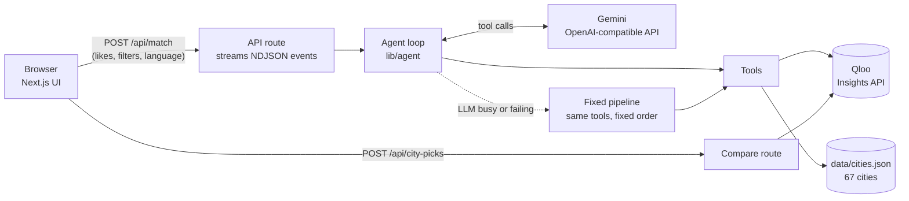

# TasteAbroad

Find the university city abroad where you'd actually feel at home.

**Live demo: [tasteabroad.vercel.app](https://tasteabroad.vercel.app)** (no login needed)


Millions of students choose where to study abroad by rankings and price, then feel lost because
the city doesn't fit them. TasteAbroad adds the missing question: **will I feel at home there?**

You type what you love, like artists, films, shows, food and hobbies. An AI agent uses
[Qloo](https://www.qloo.com/)'s taste graph to rank 67 university cities around the world by
cultural fit, then shows well-known universities, typical international tuition, the monthly cost
of living and a short explanation of why each city fits you.

## Features

- **Taste-based city matching** for 67 student cities on every continent, scored by Qloo.
- **Visible AI agent**: every step and tool call is streamed live to the page, with a full agent trace.
- **City cards** with match score, "why you'd fit", universities with links, tuition and monthly costs.
- **Compare two cities** side by side, including places in each city that people with your taste love (from Qloo).
- **"People like you also liked..."**: music, films, TV and places from Qloo.
- **Optional filters** for tuition, monthly budget, language of study and region.
- **Shareable links**: likes, filters and language live in the URL.
- **English, Albanian and German**, including the AI-written explanations.
- **Mobile-first**, light and dark mode.

## How Qloo is used

Qloo is not a side feature: without it there is no result. The agent has four tools:

| Tool | What it does | Qloo endpoint |
| --- | --- | --- |
| `qloo_search` | Turns each like into a Qloo **entity** (Dua Lipa, Studio Ghibli) or **tag** (techno, street food, hiking) | `GET /search`, `GET /v2/tags` |
| `qloo_destination_affinity` | Scores all dataset cities by taste affinity in one call, plus Qloo's worldwide top destinations | `GET /v2/insights` with `filter.type=urn:entity:destination` and `filter.results.entities` |
| `qloo_similar` | "People like you also liked" across artists, films, TV shows and places | `GET /v2/insights` with other `filter.type` values |
| `get_city_info` | Universities, tuition and living costs from our curated dataset | `data/cities.json` |

The compare view adds one more Qloo call per city: places inside that city (`filter.type=urn:entity:place`
with `filter.location`) that people with the same taste rate highest.

**Who decides what:** Qloo decides which cities fit and how strongly; every match score is a Qloo
affinity. The LLM decides which lookups to make and writes the explanations, but it can only use
IDs and cities that Qloo actually returned.

## Architecture



- `lib/qloo.ts`: typed Qloo client with timeouts, bounded retries, an in-memory cache and typed errors.
- `lib/llm.ts`: small OpenAI-compatible chat client. Gemini by default; any compatible provider works through env vars. Busy models fall through to the next one.
- `lib/agent/`: tools, agent loop, fixed fallback pipeline and the explanation writer.
- `app/api/match/route.ts`: validates input, rate-limits per IP, caches identical searches for 30 minutes, streams progress.
- API keys are only read in server code; the browser bundle never contains them.

### When things go wrong

| Situation | What the user sees |
| --- | --- |
| Gemini is busy or rate-limited | The next model is tried; if all fail, the fixed pipeline finishes the job and simpler explanations are shown |
| Qloo recognises nothing | A clear message asking for well-known artists, films or hobbies |
| Some likes are not recognised | Results for the rest, plus a note listing what was skipped |
| Filters match no city | Filters are relaxed step by step (budget first, region last) with a note |
| Qloo has no score for a city | A nearby stand-in is scored and labelled (Seoul via Suwon, Lima via Miraflores) |
| Too many requests | A friendly "wait a minute" message instead of an error page |

## Tech stack

Next.js 16 (App Router) · TypeScript (strict) · Tailwind CSS 4 · Google Gemini (function calling) · Qloo Insights API · Vercel

## Local setup

Requires Node.js 20.9 or newer.

```bash
git clone https://github.com/Devvzz/tasteabroad.git
cd tasteabroad
npm install
cp .env.example .env.local   # then fill in your own keys
npm run dev
```

Open http://localhost:3000.

### Environment variables

| Name | Purpose |
| --- | --- |
| `QLOO_API_KEY` | Qloo API key (server-side only) |
| `GEMINI_API_KEY` | Google Gemini API key (server-side only) |
| `QLOO_BASE_URL` | Optional, defaults to `https://hackathon.api.qloo.com` |
| `LLM_MODEL` | Optional, defaults to `gemini-3.1-flash-lite` |
| `LLM_FALLBACK_MODELS` | Optional, comma-separated models tried when the main one is busy |
| `LLM_WRITER_MODEL` | Optional, model that writes the city explanations |
| `LLM_BASE_URL` / `LLM_API_KEY` | Optional, point the agent at any OpenAI-compatible provider |

Never commit `.env.local`; `.gitignore` already excludes it.

### Scripts

| Command | What it does |
| --- | --- |
| `npm run dev` | Starts the app locally |
| `npm run build` | Production build |
| `npm run test:qloo` | Smoke-tests the Qloo client and checks that every city can be scored |
| `npm run test:agent -- "Dua Lipa" "anime"` | Runs the full agent once and prints each step |
| `npm run resolve:cities` | Looks up the Qloo destination ID for new cities in `data/cities.json` |

## Deploy to Vercel

1. Push the repo to GitHub.
2. On [vercel.com/new](https://vercel.com/new), import the repo. The Next.js preset needs no changes.
3. Under **Environment Variables**, add `QLOO_API_KEY` and `GEMINI_API_KEY`.
4. Deploy. Every later push to `main` redeploys automatically.

## Data

`data/cities.json` holds 67 cities with country, region, coordinates, 2 to 3 universities with
official links, typical international tuition, a monthly student budget in EUR and USD, teaching
languages and student-life tags. Each city has a `source`, a `checked` date and is marked
`estimate, check official site`. Values are rough ranges, never quotes.

## Limitations

- Qloo scores describe what groups of people with similar tastes enjoy. They are not a prediction
  about one person and say nothing about admission chances, visas or safety.
- Tuition and living costs are estimates and change every year.
- The free Gemini tier is rate-limited, so explanations sometimes fall back to simpler text.

## Licence

[MIT](LICENSE)
