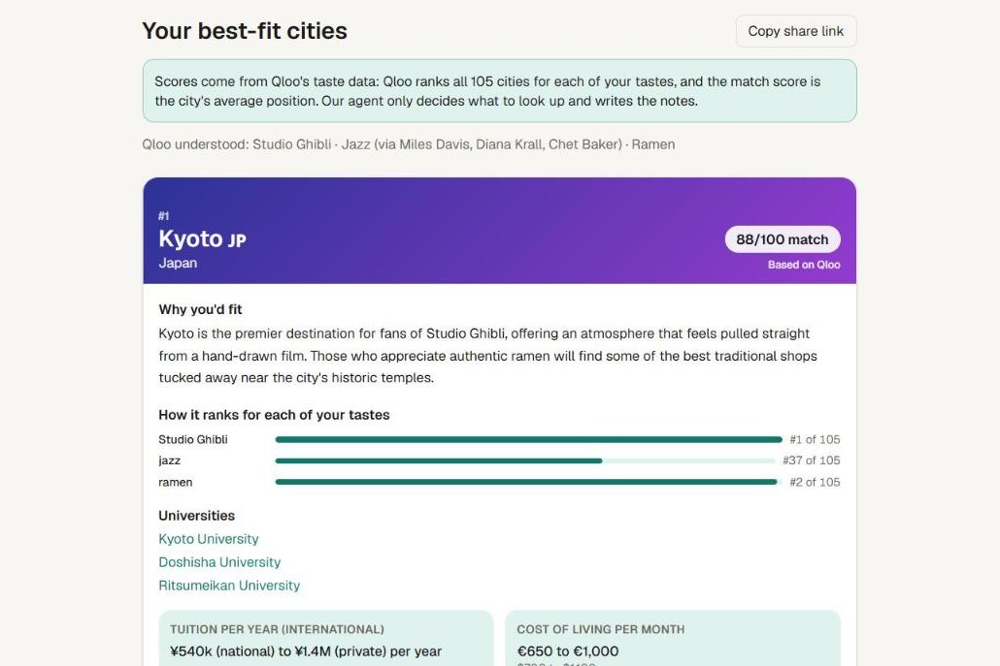
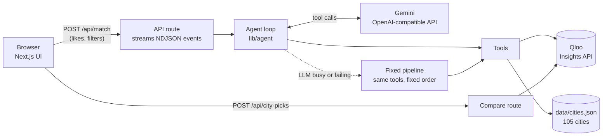

# TasteAbroad

Find the university city abroad where you'd actually feel at home.

**Live demo: [tasteabroad.vercel.app](https://tasteabroad.vercel.app)** (no login needed)



Millions of students choose where to study abroad by rankings and price, then feel lost because
the city doesn't fit them. TasteAbroad answers three questions together:

1. **Will I fit in culturally?** Your taste in music, film, food and hobbies, matched by Qloo.
2. **Can I study there in a language I speak?** English-taught programmes first, other languages optional.
3. **Can I afford it?** Typical international tuition and the monthly cost of living.

You type what you love, like artists, films, shows, food and hobbies. An AI agent uses
[Qloo](https://www.qloo.com/)'s taste graph to rank a curated list of 105 university cities
around the world by cultural fit, then shows well-known universities, typical international
tuition, the monthly cost of living and a short explanation of why each city fits you.

> **Every match score is built from Qloo's data, never by the AI.** Qloo ranks all 105 cities
> separately for each of your tastes; a city's score is its average position across those rankings
> (100 means first for every taste). Each card shows the breakdown, for example
> "jazz #2 of 105 · anime #17 of 105". The AI only decides which Qloo lookups to make and writes
> the explanations around Qloo's results.

## Features

- **Taste-based city matching** for 105 student cities on every continent, scored by Qloo.
- **Live autocomplete from Qloo** while you type ("tay" suggests Taylor Swift, "sush" suggests Sushi), plus grouped ideas.
- **Visible AI agent**: every step and tool call is streamed live to the page, with a full agent trace.
- **City cards** with a match score and a per-taste breakdown ("Dua Lipa #6 of 105 · jazz #6 of 105"), "why you'd fit", universities with links, tuition and monthly costs.
- **Study language**: one switch for English-taught programmes, plus "I also speak..." for other languages
  (useful for free or cheap public degrees in the local language).
- **Compare two cities** side by side, including places in each city that people with your taste love (from Qloo).
- **"People like you also liked..."**: music, films, TV and places from Qloo.
- **Optional filters** for tuition, monthly budget and region.
- **Shareable links**: likes and filters live in the URL.
- **Mobile-first**, light and dark mode.

## How Qloo is used

Qloo is not a side feature: without it there is no result. The agent has four tools:

| Tool | What it does | Qloo endpoint |
| --- | --- | --- |
| `qloo_search` | Turns each like into a Qloo **entity** (Dua Lipa, Studio Ghibli) or **tag** (techno, street food, hiking) | `GET /search`, `GET /v2/tags` |
| `qloo_destination_affinity` | Ranks all dataset cities once per taste and combines the ranks, plus Qloo's worldwide top destinations | `GET /v2/insights` with `filter.type=urn:entity:destination` and `filter.results.entities` |
| `qloo_similar` | "People like you also liked" across artists, films, TV shows and places | `GET /v2/insights` with other `filter.type` values |
| `get_city_info` | Universities, tuition and living costs from our curated dataset | `data/cities.json` |

The compare view adds one more Qloo call per city: places inside that city (`filter.type=urn:entity:place`
with `filter.location`) that people with the same taste rate highest. The input field also uses
`GET /search` and `GET /v2/tags` for live autocomplete, ranked by Qloo popularity.

### How the match score works

Scoring all tastes in one Qloo call squeezed every city into a few points (0.69 to 0.82 across all
105 cities in one test), and one famous name drowned out the rest. So each taste is scored on its own:

1. **Names** (artists, films, brands) are sent to Qloo directly.
2. **Genres and hobbies** mostly have no city data of their own: on their own, tags like "jazz",
   "techno" or "climbing" give every destination the same affinity. They are scored through the
   entities Qloo associates with them instead: jazz through Miles Davis, Diana Krall and Chet Baker;
   climbing through climbing films. Film and TV bridges must actually carry the tag. Food tags such as
   "street food" carry city data and are used directly.
3. Qloo ranks all 105 cities for each taste. A city's score is its average percentile across tastes,
   so a city has to fit all of them, not just one. Ties go to the higher average affinity.
4. Tastes Qloo has no city data for are left out of the ranking, and the page says so.

**Who decides what:**

| | Decides |
| --- | --- |
| **Qloo** | Where every city ranks for each of your tastes. The match score and ranking are calculated from those Qloo rankings only. |
| **AI agent (Gemini)** | Which Qloo lookups to make, and the wording of the explanations. The tools only accept IDs that a Qloo search returned, and the city list is built from Qloo's response, not from the model's text. |
| **Our dataset** | Universities, tuition, living costs and teaching languages (rough ranges, marked as estimates). |

## Architecture



- `lib/qloo.ts`: typed Qloo client with timeouts, bounded retries, an in-memory cache and typed errors.
- `lib/llm.ts`: small OpenAI-compatible chat client. Gemini by default; any compatible provider works through env vars. Busy models fall through to the next one.
- `lib/agent/`: tools, agent loop, fixed fallback pipeline and the explanation writer.
- `app/api/match/route.ts`: validates input, rate-limits per IP, caches identical searches for 30 minutes, streams progress.
- API keys are only read in server code; the browser bundle never contains them.

### When things go wrong

| Situation | What the user sees |
| --- | --- |
| Gemini is busy or rate-limited | The next model is tried; if all fail, the fixed pipeline finishes the job and simpler explanations are shown |
| Qloo recognises nothing | A clear message asking for well-known artists, films or hobbies |
| Some likes are not recognised | Results for the rest, plus a note listing what was skipped |
| Filters match no city | Filters are relaxed step by step (budget first, region last) with a note |
| Qloo has no score for a city | A nearby stand-in is scored and labelled (Seoul via Suwon, Lima via Miraflores) |
| Too many requests | A friendly "wait a minute" message instead of an error page |

## Tech stack

Next.js 16 (App Router) · TypeScript (strict) · Tailwind CSS 4 · Google Gemini (function calling) · Qloo Insights API · Vercel

## Local setup

Requires Node.js 20.9 or newer.

```bash
git clone https://github.com/Devvzz/tasteabroad.git
cd tasteabroad
npm install
cp .env.example .env.local   # then fill in your own keys
npm run dev
```

Open http://localhost:3000.

### Environment variables

| Name | Purpose |
| --- | --- |
| `QLOO_API_KEY` | Qloo API key (server-side only) |
| `GEMINI_API_KEY` | Google Gemini API key (server-side only) |
| `QLOO_BASE_URL` | Optional, defaults to `https://hackathon.api.qloo.com` |
| `LLM_MODEL` | Optional, defaults to `gemini-3.5-flash-lite` |
| `LLM_FALLBACK_MODELS` | Optional, comma-separated models tried when the main one is busy |
| `LLM_WRITER_MODEL` | Optional, model that writes the city explanations |
| `LLM_BASE_URL` / `LLM_API_KEY` | Optional, point the agent at any OpenAI-compatible provider |

Never commit `.env.local`; `.gitignore` already excludes it.

### Scripts

| Command | What it does |
| --- | --- |
| `npm run dev` | Starts the app locally |
| `npm run build` | Production build |
| `npm run test:qloo` | Smoke-tests the Qloo client and checks that every city can be scored |
| `npm run test:agent -- "Dua Lipa" "anime"` | Runs the full agent once and prints each step |
| `npm run resolve:cities` | Looks up the Qloo destination ID for new cities in `data/cities.json` |

## Deploy to Vercel

1. Push the repo to GitHub.
2. On [vercel.com/new](https://vercel.com/new), import the repo. The Next.js preset needs no changes.
3. Under **Environment Variables**, add `QLOO_API_KEY` and `GEMINI_API_KEY`.
4. Deploy. Every later push to `main` redeploys automatically.

## Data

`data/cities.json` holds a hand-picked list of 105 well-known student cities across all world
regions (Europe 38, Asia 19, North America 16, Latin America 10, Africa 9, Oceania 7, Middle
East 6). The list is curated, not taken from a ranking; Qloo then scores every city on it for each
search. Every city was checked to have a Qloo destination that can be scored, and cities Qloo
has no entry for were left out. Seoul and Lima are scored through a district in the same metro
area (Suwon, Miraflores), which the card says openly.

Each city has country, region, coordinates, 1 to 3 universities with official links, typical
international tuition, a monthly student budget in EUR and USD, teaching languages and
student-life tags, plus a `source`, a `checked` date and the mark `estimate, check official site`.
Values are rough ranges, never quotes.

## Limitations

- Qloo scores describe what groups of people with similar tastes enjoy. They are not a prediction
  about one person and say nothing about admission chances, visas or safety.
- Tuition and living costs are estimates and change every year.
- The free Gemini tier is rate-limited, so explanations sometimes fall back to simpler text.

## Licence

[MIT](LICENSE)
